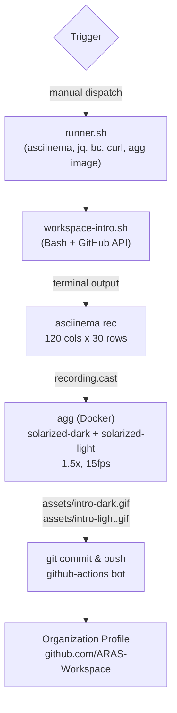

# ARAS Workspace Organization Profile (.github) Repository

Organization profile and shared configurations for [ARAS-Workspace](https://github.com/ARAS-Workspace).

## Overview

This repository contains:

- **Organization Profile** — Dynamic terminal animation displayed on the organization page
- **Workflows** — GitHub Actions for automated content generation

## Pipeline



## Structure

```
.github/
├── profile/
│   └── README.md                ← Organization profile
├── assets/
│   ├── intro-dark.gif           ← Dark mode animation (auto-generated)
│   └── intro-light.gif          ← Light mode animation (auto-generated)
├── scripts/
│   └── workspace-intro.sh       ← Animation script
└── .github/
    ├── main/
    │   └── scripts/
    │       └── runner.sh        ← Workflow dependency setup
    └── workflows/
        └── generate-intro.yml   ← Animation workflow
```

## Animation

The script simulates an SSH session to the workspace and runs:

| Command           | Output                                                   |
|-------------------|----------------------------------------------------------|
| `cat /etc/motd`   | ASCII banner                                             |
| `whoami`          | Author name and email                                    |
| `pwd`             | `/home/ARAS-Workspace`                                   |
| `ls -l projects/` | Public repositories, one per line, sorted by star count  |

Repositories are fetched from the GitHub API. Ties in star count are ordered by most recently updated. When `GITHUB_TOKEN` is set, API requests are authenticated to avoid rate limits.

## Configuration

Editable constants in [`scripts/workspace-intro.sh`](scripts/workspace-intro.sh):

```bash
# GitHub
GITHUB_ORG="ARAS-Workspace"

# Excluded repositories
specialExcludedRepos=(".github")

# Domain & SSH
DOMAIN="aras.tc"
SSH_USER="workspace"
SSH_HOST="aras"
GUEST_USER="guest"
GUEST_HOST="local"

# Branding
AUTHOR_NAME="Rıza Emre ARAS"
AUTHOR_EMAIL="r.emrearas@proton.me"

# Animation Timing
TYPING_SPEED=0.05          # Base typing speed (seconds)
TYPING_VARIANCE=0.03       # Random variance per keystroke
COMMAND_PAUSE=0.4          # Pause after typing a command
LINE_PAUSE=0.2             # Pause between lines
SECTION_PAUSE=1.2          # Pause between sections
```

## Workflow

The `generate-intro.yml` workflow runs on a GitHub-hosted runner (`ubuntu-latest`). It installs dependencies via [`runner.sh`](.github/main/scripts/runner.sh), records the terminal animation using [asciinema](https://asciinema.org/) and converts it to GIF using [agg](https://github.com/asciinema/agg).

**Trigger:** Manual dispatch

A single recording is converted into both variants and committed together:

| Output                   | Theme             | Used in profile          |
|--------------------------|-------------------|--------------------------|
| `assets/intro-dark.gif`  | `solarized-dark`  | `#gh-dark-mode-only`     |
| `assets/intro-light.gif` | `solarized-light` | `#gh-light-mode-only`    |

The recording is 120 × 30. Each listed project takes one row, so up to 13 projects fit without scrolling. Increase `--rows` in the workflow if the project count grows beyond that.

## License

This project is licensed under the MIT License — see the [LICENSE](LICENSE) file for details.

Third-party software licenses are documented in [THIRD_PARTY_LICENSES](THIRD_PARTY_LICENSES).
